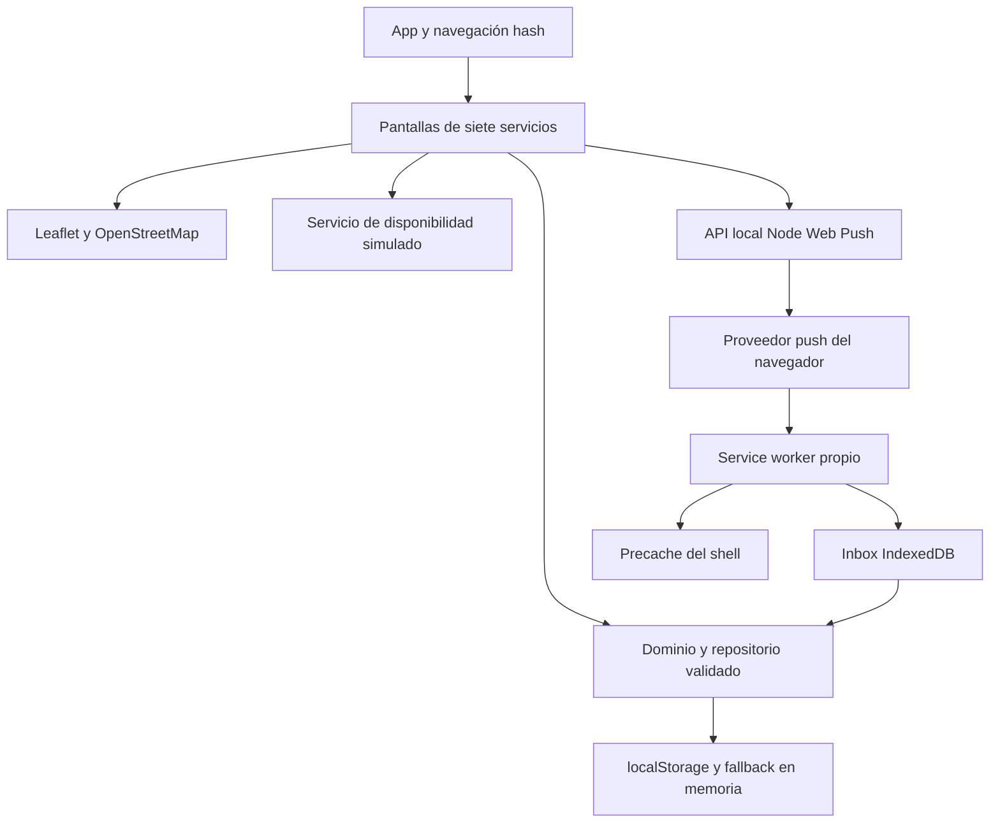

# Informe técnico del TP5

## Resultado y alcance

San Francisco Vecino es una PWA con siete módulos municipales. React y TypeScript organizan interfaz, modelos y reglas; Vite genera los recursos y el service worker. El cumplimiento se contrasta con las evidencias de PRUEBAS: una compilación correcta no sustituye una ejecución móvil.

La revisión acotada de fuentes oficiales no localizó APIs municipales públicas documentadas. Se mantienen simulaciones de trámites, pagos, disponibilidad y alarmas hasta disponer de acceso. No se sondearon endpoints privados ni se usaron credenciales municipales. Los enlaces a portales no se presentan como contratos API.

## Arquitectura y justificación

| Componente | Decisión y responsabilidad |
|---|---|
| React y TypeScript | Componentes reutilizables para siete módulos y contratos de datos comprobados al compilar. Cada pantalla se monta como componente independiente. |
| Pantallas y dominio | `screens/` presenta flujos; `modules/` concentra validación, pagos simulados, temporizadores, preferencias y eventos. |
| Repositorio | Aísla localStorage, valida cada registro y conserva cambios en memoria si se rechaza una escritura. Permite sustituir la persistencia sin rehacer las pantallas. |
| Leaflet | Coordenadas geográficas, marcadores y polígonos distintos por servicio; carga de biblioteca separada y lista accesible como alternativa. |
| Servicio de bicicletas | Contrato reemplazable que publica disponibilidad variable, anclajes y fecha. Respeta capacidad y cancela su temporizador sin suscriptores. |
| Node y Web Push | Emisor pequeño, sin base externa ni cuenta Firebase. Sirve el build y la API en el mismo origen local. |
| Worker e IndexedDB | Recibe push, muestra aviso y admite destinos internos. Conserva eventos cuando no hay pestaña abierta y los mezcla al volver. |
| Vite PWA | `injectManifest` permite eventos propios conservando precache de la aplicación. No almacena masivamente teselas externas. |

## Integraciones y simulaciones

El mapa base de OpenStreetMap es real y muestra atribución. Tecnoteca y Terminal usan posiciones aproximadas de POI verificables; no se afirma que sean coordenadas oficiales de anclajes. Alarmas y polígonos de estacionamiento son fixtures ficticios independientes. Sin conexión permanecen listas y datos locales, pero no se promete mapa base completo.

La geolocalización se solicita por botón y se usa para distancias en memoria; no se envía al emisor. La disponibilidad de bicicletas cambia cada diez segundos con capacidad constante. Alarmas se activan/desactivan mediante acciones demostrativas, sin controlar equipos reales.

El WhatsApp de Tana procede de la página oficial de contactos. Abrirlo requiere una acción del usuario y no envía automáticamente mensajes. Los demás canales ficticios y mensajes internos quedan diferenciados.

Reclamos conserva archivos JPG/PNG/PDF completos hasta 512 KiB por adjunto con presupuesto conjunto. Se valida tipo, tamaño, base64 y contenido persistido. Cedulones y comprobantes TXT llevan leyenda de simulación sin validez fiscal; no se solicitan tarjetas ni claves bancarias.

## Transporte Web Push

La clave privada VAPID y las suscripciones quedan en `.local/`, excluido del repositorio y del contenido servido. Cada registro tiene una credencial para modificar preferencias, cancelar y enviar solo a su propia suscripción. Volver a registrar un endpoint existente exige la credencial anterior. Se validan origen, tamaño de solicitud y proveedores HTTPS conocidos; hay límites de intentos y limpieza de suscripciones vencidas.

La prueba se programa diez segundos después para permitir cerrar la pestaña. El contenido municipal es ficticio; el transporte es real. HTTP 202 confirma programación, y aceptación del proveedor no implica recepción del sistema operativo. Los resultados diferidos se registran sin secretos y los errores se contienen, incluso ante una falla de disco.

El worker guarda hasta 100 eventos en IndexedDB y solo abre destinos internos conocidos. Al volver, la aplicación consulta el historial más reciente después de esperar el inbox, para conservar eventos locales y cambios de lectura concurrentes. La cuota diaria utiliza el día de Argentina, por tipo/zona y separadamente por canal. Pausar no elimina el historial. Los recordatorios locales de tributos y estacionamiento requieren la app abierta; no se presentan como tareas remotas de servidor.

El servidor es educativo y se enlaza a 127.0.0.1. Para publicar se necesitarían HTTPS, políticas de origen y autenticación/autorización apropiadas; no se expone automáticamente a Internet. Un teléfono físico no puede usar todas estas capacidades mediante la IP HTTP de la computadora.

## Problemas encontrados y soluciones

| Problema | Solución |
|---|---|
| Pantallas invocadas como funciones mezclaban Hooks y rompían navegación. | Montaje JSX independiente y prueba Reclamos → Notificaciones, hash y Atrás/Adelante. |
| Almacenamiento rechazado hacía reaparecer un valor anterior; registros corruptos rompían UI. | Prioridad de memoria para escrituras fallidas y validación por registro. |
| Adjuntos solo tenían metadatos o base64 inválido. | Archivo completo, límites y validación de decodificación antes de descargar. |
| Avisos diarios contaban eventos suprimidos o cambiaban de día a medianoche UTC. | Fecha de entrega efectiva y día de Argentina; canal push separado del local. |
| Importación asíncrona de push podía borrar un vencimiento local concurrente. | Esperar IndexedDB antes de leer/mezclar el historial, con regresión de lectura diferida. |
| Registrar de nuevo un endpoint permitía obtener la credencial existente. | Exigir propietario previo y probar rechazos y actualización autorizada. |
| Una promesa diferida rechazada podía terminar Node. | Contener el resultado y los fallos de persistencia; diagnóstico sin datos de suscripción. |
| Un estilo SVG antiguo ocultaba los marcadores de Leaflet. | Acotar el selector al SVG directo y verificar clic real sobre el marcador. |
| La primera carga móvil simulada superó tres segundos. | Compresión gzip de estáticos textuales, caché acotada y negociación con `Vary`; verificar descompresión exacta y `gzip;q=0`. |

## Calidad y entrega

Pruebas automatizadas, TypeScript y lint verifican reglas y contratos: 45 pruebas frontend y seis del servidor aprobaron, con un total actual de 51. La ejecución de navegador verificó recorridos móviles/escritorio, mapas seleccionables y fallback offline. El transporte Web Push se comprobó con una suscripción FCM genuina desde un perfil Chrome de prueba: pestaña cerrada, worker receptor, recuperación del historial y cancelación. No se confunde este resultado con el despacho sintético utilizado antes para aislar el worker.

La carga móvil simulada bajó de aproximadamente 3,55 s de contenido visible a 1,75 s al incorporar gzip estático; FCP/LCP observado 1,764 s. La verificación de navegador cerró con 28 de 28 comprobaciones aprobadas y cero errores de la aplicación. La matriz está en [PRUEBAS](PRUEBAS.md) y el material sanitizado en [evidencias](evidencias/QA_REPORT.md). Los resultados anteriores a las correcciones se conservan como historial, no como fallos actuales.

No se certifican todos los dispositivos o navegadores ni el banner/clic físico del sistema operativo. Los datos personales deben ser ficticios en la demostración; validación y permisos no certifican por sí solos cumplimiento normativo productivo.

README contiene ejecución y recorrido. El alumno debe preparar el repositorio remoto y la demostración en clase; ninguna publicación se realiza automáticamente.

## Fuentes

- Consigna TP5, páginas 5 a 8, Arquitecturas Móviles, UTN Facultad Regional San Francisco.
- Estaciones municipales: https://www.sanfrancisco.gov.ar/contenidos/san-fco-en-bici-285
- Contactos y Tana: https://www.sanfrancisco.gov.ar/contenidos/contactos-356
- Recursos Tributarios: https://municipio.sanfrancisco.gov.ar/drt/Servicios
- Atención Ciudadana: https://www.sanfrancisco.gov.ar/contenidos/centro-de-atencion-ciudadana-301
- Centro urbano: https://www.openstreetmap.org/node/3799258579
- Tecnoteca: https://www.openstreetmap.org/way/1502554692
- Terminal: https://www.openstreetmap.org/node/3534492845
- Leaflet: https://leafletjs.com/reference.html
- Política de teselas: https://operations.osmfoundation.org/policies/tiles/
- Emisor Web Push: https://github.com/web-push-libs/web-push
- Worker propio: https://vite-pwa-org.netlify.app/guide/inject-manifest
